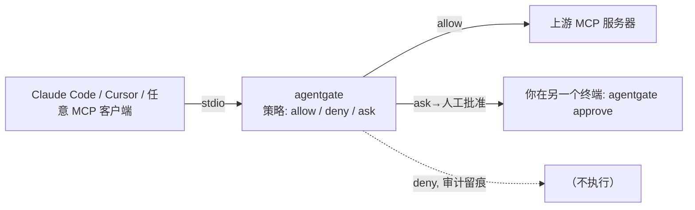

# agentgate

**Agent 原生 MCP 授权网关**：每次工具调用逐次鉴权、危险操作人类审批、审批可转为限时范围委托（scoped delegation）、全程追加式审计。

对标 Permit.io MCP Gateway / Auth0 for GenAI 的**开源自托管替代**。选型依据见仓库上层 `research/调研报告_agent项目选型.md`（方向 C1：商业三家闭源验证需求，开源空白）。



## 30 秒上手

```bash
pip install -e .
# 用示例策略启动网关（对 MCP 客户端表现为一个普通 MCP 服务器）
python -m agentgate run --config policies/example.yaml --agent claude-code

# Claude Code 接入（一行）：
claude mcp add agentgate -- python -m agentgate run --config policies/example.yaml --agent claude-code
```

策略里 `ask` 的工具被调用时，网关会打印审批指引并在 `--allow` 之前一直阻塞该调用：

```bash
agentgate pending                 # 查看待审批
agentgate approve <id> --allow    # 批准（可带 delegation：限时、绑定参数）
agentgate log -n 50               # 查看审计
agentgate grants                  # 查看有效委托
agentgate revoke <grant_id>       # 即时撤销
```

## 特性

- **fail-closed**：无规则、异常、未知工具、审批超时一律拒绝；默认决策 `deny`
- **声明式策略**：YAML——agent × server × 工具 glob × 参数条件（`args_match`）× 决策
- **人类审批**：文件式协议，无需端口、无需了解 MCP，任何终端可用
- **范围委托**：批准一次 = 在 TTL 内（可选绑定到完全相同参数）重复放行，可随时 revoke
- **审计**：JSONL 追加式、fsync 落盘，每次调用必有决策留痕
- **prompts/resources 代理**（V1.1）：协议完整覆盖，server 级能力开关
- **HTTP 入口**（V1.1）：`--http HOST:PORT`，多客户端共享一个网关
- **审批签名**（V1.1）：`AGENTGATE_APPROVAL_SECRET` 环境变量启用 HMAC 验签，伪造裁决失效

## 文档

- [用户使用手册](docs/manual.md) —— 安装、策略编写、审批工作流、排障
- [需求规格（SRS V1.0）](docs/srs.md) —— 功能/非功能需求、追踪矩阵、审核日志
- [设计文档](docs/design.md) —— 架构图、时序图、状态图、数据模型、安全设计

## 测试

```bash
pip install -e ".[dev]"
pytest            # 39 tests: 单元 + 真实子进程端到端
```

## 状态与已知局限（v0.1）

- stdio 入口（HTTP 入口 / Web 审批台 / prompts-resources 代理为路线图 EX-1/2/4）
- 审批文件未做密码学签名（同机信任域假设；签名方案见 EX-3）
- `grants.json` 运行期单写者（网关）；损坏时按更严格方向降级
- 更多：见 `docs/design.md` §6 与 `docs/manual.md` 排障一节

License: Apache-2.0
