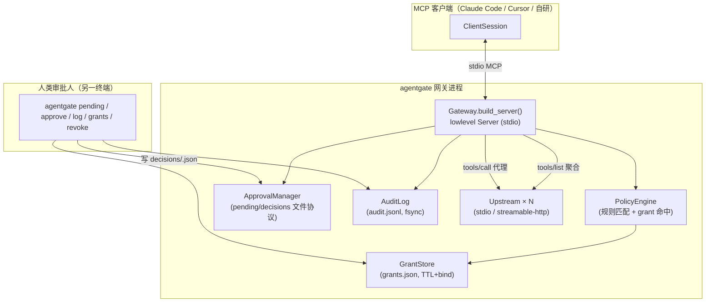
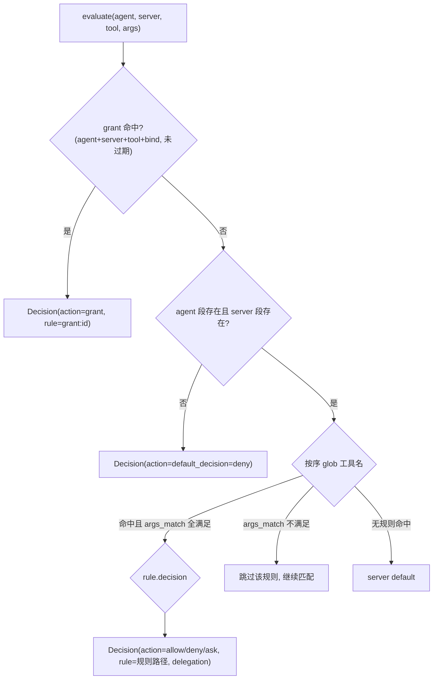
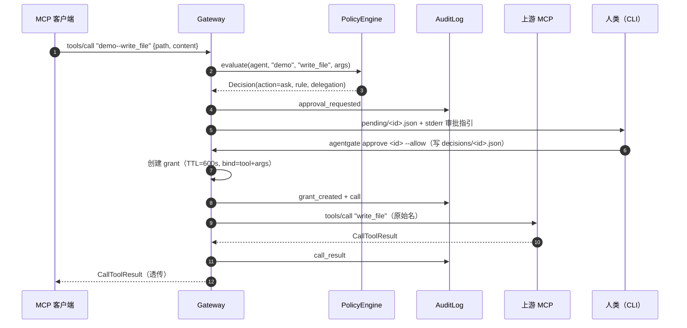
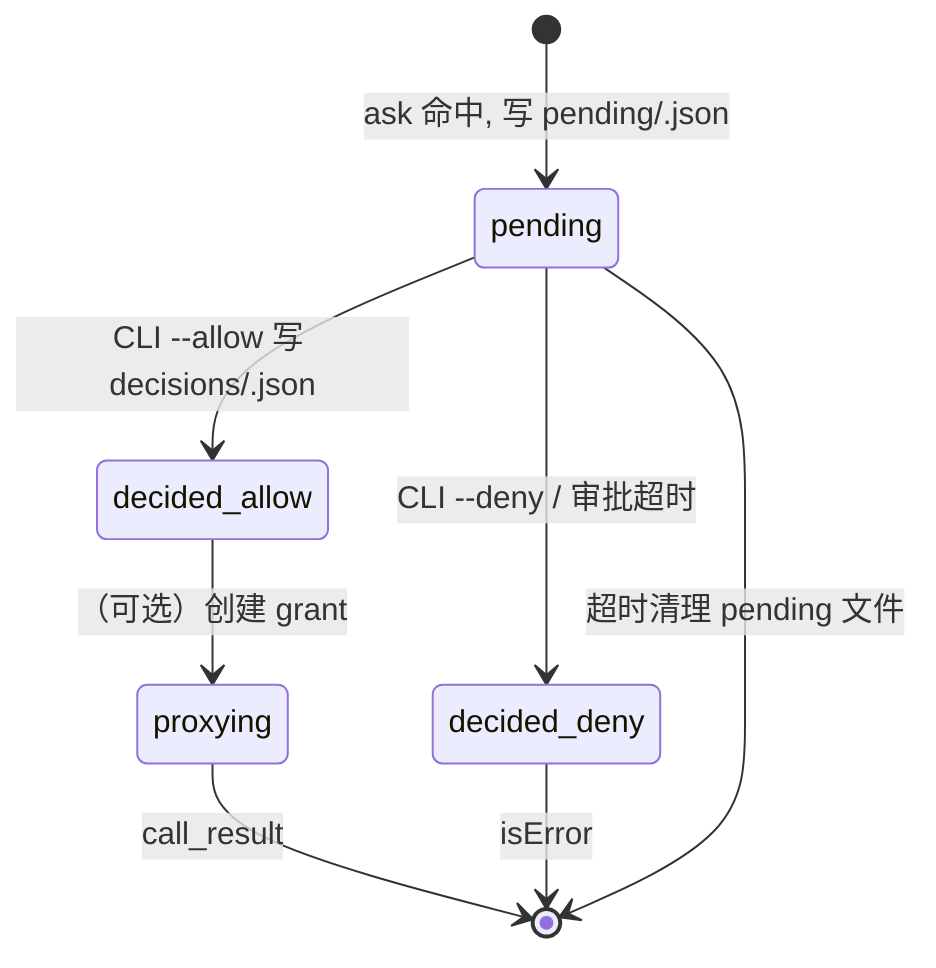
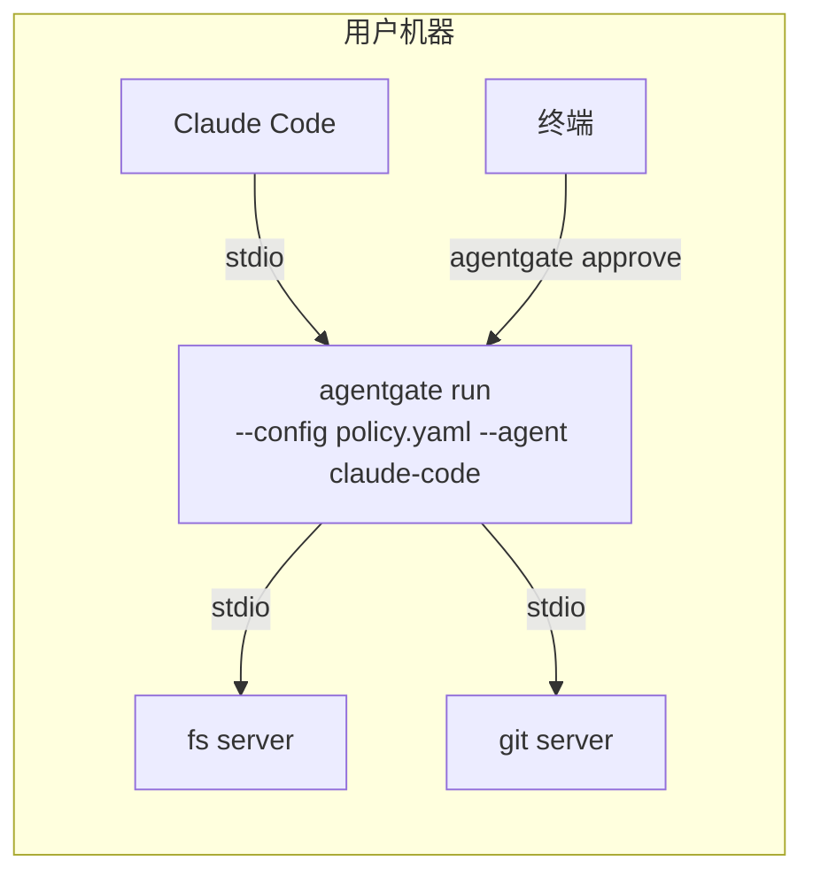

# agentgate 设计文档（v0.1）

> 对应 SRS：`docs/srs.md` V1.0。图示为 Mermaid，可在 GitHub/ZCode 直接渲染。

## 1. 设计目标与原则

1. **Fail-closed**：任何不确定（无规则、异常、超时、未知工具）一律拒绝（NFR-SEC-001）。
2. **可审计**：每次工具调用必有决策留痕，审计写入 fsync（NFR-SEC-002）。
3. **标准贴合**：以 MCP 为唯一协议面；策略/审批语义对齐 OWASP ACS（hooks + 策略强制点）与五眼指南"最小权限 + 持续审计"。
4. **零服务部署**：单进程、纯文件状态目录，自托管用户 `pip install` 即用。
5. **可替换内核**：PolicyEngine / ApprovalManager 是唯一判定与审批入口，为 EX-5（OPA 适配）、EX-2（Web 审批台）预留（SRS §7）。

## 2. 总体架构



要点：
- 网关对客户端是 `agentgate-<agent>` 的普通 MCP 服务器；对上游是标准 MCP 客户端（复用官方 SDK 双向实现，不重造协议）。
- 工具命名空间 `<server>--<tool>`（`--` 为分隔符；MCP 工具名仅允许 `[A-Za-z0-9_-]`，故选双连字符避免歧义）。
- 状态目录 `.agentgate/`：`audit.jsonl`、`pending/`、`decisions/`、`grants.json`。

## 3. 模块划分

```
src/agentgate/
├── config.py     # 策略/配置加载与校验（ConfigError 带位置语义）   [FR-PL-001]
├── policy.py     # 决策回退链、glob/args_match、Grant 数据类        [FR-PL-002/003/004]
├── grants.py     # 委托授权存储（原子写、TTL、revoke）              [FR-AP-003/004]
├── approvals.py  # 文件式审批协议（pending/decisions + 轮询等待）   [FR-AP-001/002/006]
├── audit.py      # JSONL 审计（flush+fsync，tail 查询）             [FR-AU-001/002]
├── upstream.py   # 上游连接（stdio/http 传输，分页聚合）            [FR-GW-002/003]
├── gateway.py    # 代理编排：拦截、决策、代理、审批、审计            [FR-GW-001..006]
└── cli.py        # run/pending/approve/log/grants/revoke            [FR-CLI-001..004]
examples/demo_server.py   # 演示上游：echo/read_file/write_file/delete_file
policies/example.yaml     # 示例策略（见 SRS §3.2 示例）
```

模块依赖单向：`cli → gateway → {policy, approvals, grants, audit, upstream} → config`。无循环依赖；核心域对象（Decision/Grant/Config）为纯 dataclass，可独立单测。

## 4. 关键流程设计

### 4.1 策略判定（PolicyEngine.evaluate）



匹配细节：
- glob 用 `fnmatch.fnmatchcase`（大小写敏感，跨平台一致）。
- `args_match` 点路径取值：dict 嵌套支持；字符串直接 glob；bool/int/float 字符串化；复杂对象 JSON 序列化后 glob；**路径缺失=不匹配**。
- 参数哈希 `canonical_args`：`json.dumps(sort_keys, separators, ensure_ascii=False)`，用于 `bind: tool+args` 与审计 `arguments_hash`。

### 4.2 tools/call 全流程（含 ask 审批）



对照分支：
- **allow / grant**：跳过 6-8 步，直接 `call` → 上游 → `call_result` → 透传。
- **deny**：`call_denied` 审计 + isError 文本（含命中规则与修改建议）。
- **ask 超时**（300s 默认）：`ask_denied`(approval timeout) + isError（fail-closed）。
- **on_ask=deny**：不产生 pending，直接 `ask_denied`(unattended) + isError。
- **未知工具/未知 server**：不进引擎，直接 isError（提示命名空间用法）。

### 4.3 审批请求生命周期（文件协议状态机）



双文件协议的意义：网关进程不监听任何端口/管道，审批人无需了解 MCP；文件天然跨终端、可脚本化、可审计（decisions 文件本身即凭证，EX-3 在此基础上加签名）。

### 4.4 失败与隔离策略

| 故障 | 行为 | 审计 |
|---|---|---|
| 策略文件缺失/非法 | 退出码 2，不启动 | 无（未进入运行态） |
| 单个上游启动失败 | 网关继续，该上游工具缺席 | `upstream_error` |
| 全部上游启动失败 | 拒绝启动（RuntimeError） | `upstream_error` ×N |
| 上游运行时调用异常 | isError（文本含异常摘要） | `upstream_error` |
| list_tools 单上游失败 | 跳过该上游，返回其余 | stderr 告警 |
| 审批超时 / 拒绝 | isError（fail-closed） | `ask_denied` |
| PolicyEngine 自身异常 | 不放行（异常向上转 isError） | `upstream_error` |

### 4.5 审计事件模型（audit.jsonl）

```json
{"ts": "2026-11-02T12:00:00+0800", "event": "call", "agent": "claude-code",
 "server": "demo", "tool": "write_file", "arguments_hash": "ab12...",
 "rule": "agents.claude-code.servers.demo.tools.\"write_file\"",
 "decision": "grant", "grant_id": "9f3c..."}
```

事件集与字段见 SRS FR-AU-001。设计取舍：审计默认只存参数**哈希**（敏感数据最小化），完整参数仅存于 pending 文件（人类审批需要看原文）；`arguments_hash` 足以对账"是哪次调用"（与 grant bind=tool+args 的哈希同构）。

### 4.6 CLI 接口

```
agentgate run      --config P.yaml --agent NAME [--state-dir D] [--on-ask pending|deny] [--ask-timeout S]
agentgate pending  [--state-dir D]
agentgate approve  <id> --allow|--deny [--approver NAME] [--state-dir D]
agentgate log      [-n N] [--state-dir D]
agentgate grants   [--all] [--state-dir D]
agentgate revoke   <grant_id> [--state-dir D]
```

### 4.7 数据结构（grants.json）

```json
[{"id": "9f3c1a2b3c4d", "agent": "claude-code", "server": "demo",
  "tool": "write_file", "args_hash": "e3b0...", "created_at": 1762000000.0,
  "expires_at": 1762000600.0, "approver": "alice"}]
```

写路径：`grants.json.tmp` 原子 `replace`，避免写撕裂。**单写者假设**：运行期由网关进程独占写；CLI `grants`/`revoke` 与网关并发使用存在读-改-写竞态（v0.1 已知局限，文件损坏时按"更严格"方向降级——清空 grants 意味着回到 ask/deny，见 NFR fail-closed）。

## 5. 技术选型与理由

| 选型 | 理由 | 替代与放弃原因 |
|---|---|---|
| 官方 `mcp` SDK 2.3（lowlevel Server + ClientSession） | 协议兼容零成本（NFR-COMPAT-001）；2.x 构造式 handler 注册干净 | 自研 JSON-RPC：工期与正确性风险 |
| lowlevel Server 而非 MCPServer(FastMCP) | 网关需要动态聚合工具与全量拦截，装饰器式静态注册不适用 | MCPServer：面向静态工具定义 |
| 文件式审批（而非端口/WS） | 零部署、跨终端、可脚本化、天然留痕 | 本地 HTTP 审批服务：增加攻击面与部署负担（EX-2 再演进） |
| JSONL 审计（而非 SQLite） | append-only 语义直白、grep 友好、fsync 简单 | SQLite：v0.1 无查询复杂度需求（V1.1 可换，接口已收敛） |
| YAML 策略 | 目标用户熟、注释友好、表达嵌套足够 | JSON：无注释；TOML：数组规则可读性差 |
| argparse（而非 typer/click） | 零额外依赖 | typer：多一个依赖无收益 |

## 6. 安全设计（对齐 SRS NFR-SEC 与外部标准）

| 威胁（OWASP 映射） | 缓解设计 |
|---|---|
| ASI03 权限滥用 / 五眼"权限蔓延" | 默认 deny 回退链（FR-PL-003）；最小规则声明 |
| T03 跨 agent 权限委托 | grant 绑定 agent 身份，不可跨 agent 复用（FR-PL-004） |
| ASI02 工具滥用 | args_match 参数级约束 + bind=tool+args 参数哈希绑定 |
| ASI10 失控 agent | ask 人工闸门 + TTL 过期 + revoke 即时撤销 |
| 审计抵赖（T08） | fsync 追加式 JSONL，决策/审批/授权三类事件全覆盖 |
| 凭据泄漏 | 策略文件不存凭据（env 注入，EX-6 预留）；代码零凭据字面量（NFR-SEC-003） |
| 审批重放（EX-3 范围） | v0.1 decisions 文件一次性消费（读后删除）；密码学绑定为 V2.0 |

已知 v0.1 局限（诚实声明）：decisions/grants 文件未签名，同机攻击者可伪造审批——威胁模型假设"审批终端与网关同机且同信任域"；跨信任域场景需 EX-3。

## 7. 测试设计

- **单元**（tests/test_policy.py 等）：ConfigError 全形态、glob/args_match/回退链、grant TTL/bind/revoke/持久化、审批文件协议、审计 fsync+tail。
- **端到端**（tests/test_e2e.py）：真实子进程链路——`python -m agentgate run`（stdio）+ `examples/demo_server.py`（上游），用官方 ClientSession 断言：
  tools/list 命名空间聚合；allow 直通；deny isError；ask→CLI 审批→grant→复用命中 grant；on_ask=deny；审计行数对账（NFR-SEC-002）；坏上游隔离（FR-GW-006）。
- **性能**：e2e 内嵌计时断言（NFR-PERF-001/002），非门禁。
- 覆盖率门禁：核心模块 ≥ 85%（NFR-MAINT-001）。

## 8. 部署形态



Claude Code 接入（一行）：
`claude mcp add agentgate -- python -m agentgate run --config policies/example.yaml --agent claude-code`
